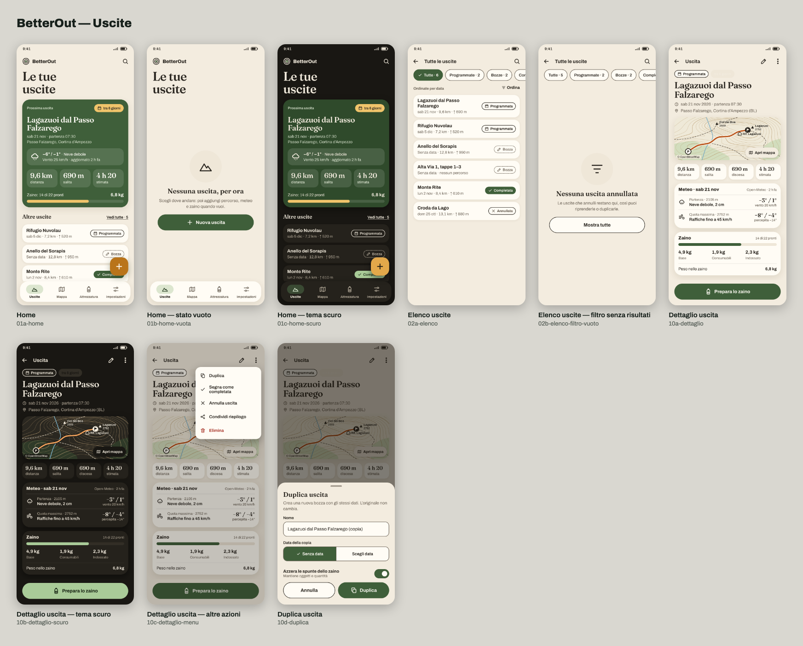

# BetterOut

App Android nativa per pianificare escursioni: uscite, percorsi su mappa e da GPX, meteo, attrezzatura e zaino. Funziona senza account e tiene i dati sul dispositivo. Il nome è provvisorio.

**Stato: in sviluppo.** Funziona la gestione delle uscite; mappa, GPX, meteo, attrezzatura, suggerimenti e backup non sono ancora implementati. Dettagli in [`docs/06-avanzamento.md`](docs/06-avanzamento.md).

## Documenti

| Documento | Contenuto |
|---|---|
| [`docs/01-specifica-funzionale.md`](docs/01-specifica-funzionale.md) | Cosa fa l'app, regole e formule |
| [`docs/02-schermate.md`](docs/02-schermate.md) | Inventario delle schermate e dei loro stati |
| [`docs/03-design-system.md`](docs/03-design-system.md) | Colori, tipografia, componenti, accessibilità |
| [`docs/04-architettura.md`](docs/04-architettura.md) | Tecnologie, strati, decisioni |
| [`docs/05-servizi-esterni.md`](docs/05-servizi-esterni.md) | Mappe, routing, quote, meteo: condizioni e limiti |
| [`docs/06-avanzamento.md`](docs/06-avanzamento.md) | Avanzamento e problemi aperti |
| [`docs/07-compilazione-collaudo.md`](docs/07-compilazione-collaudo.md) | Come compilare, installare e cosa è verificato |
| [`design/INDICE.md`](design/INDICE.md) | Bozze grafiche di tutte le schermate |

