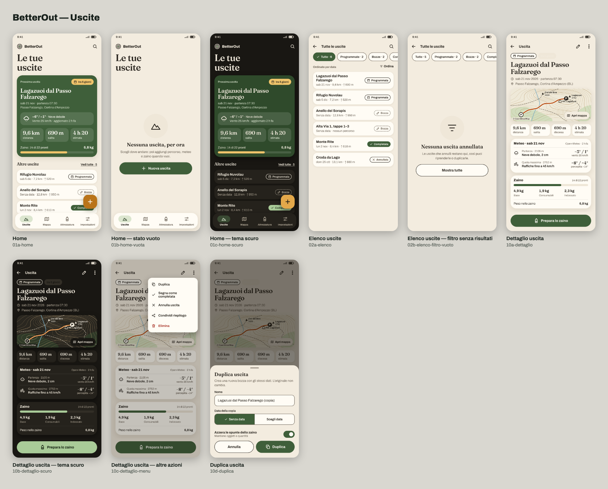
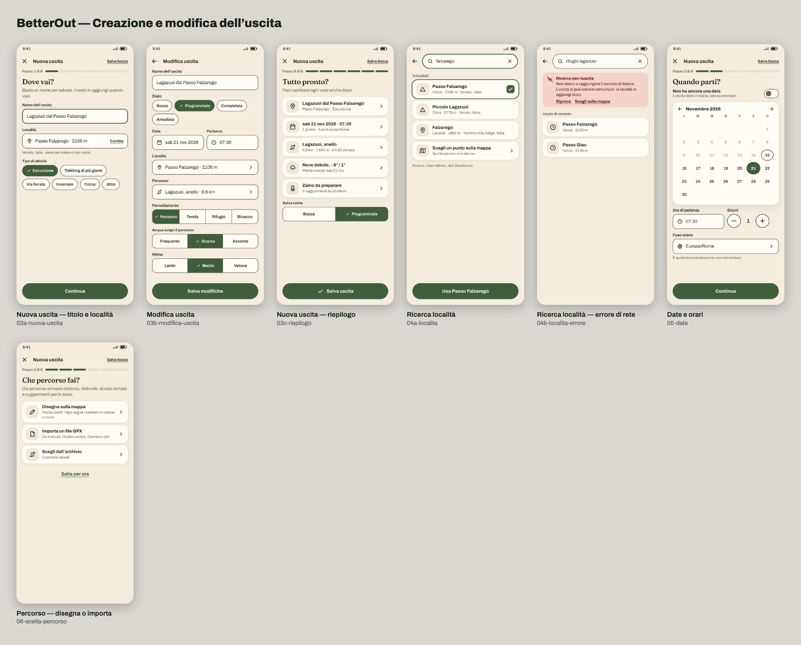
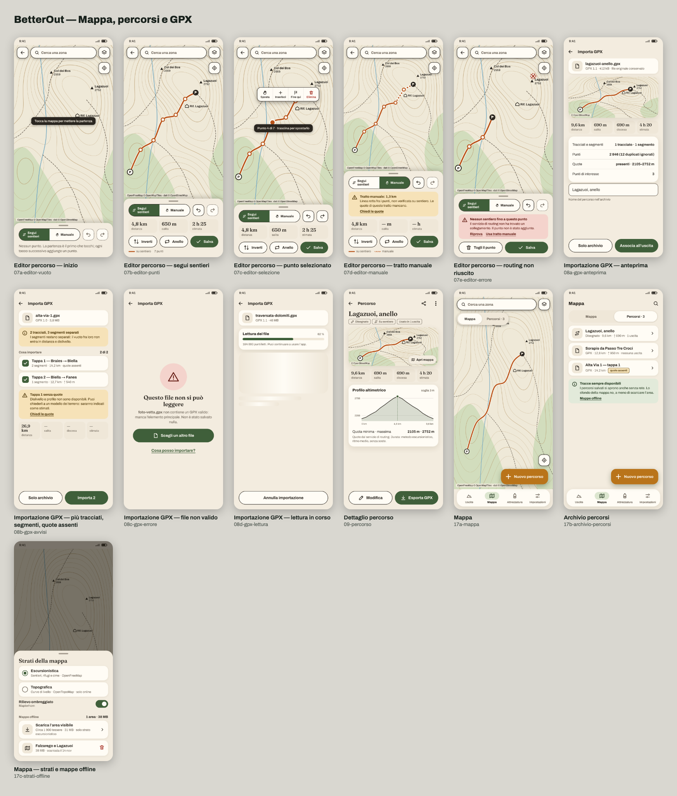
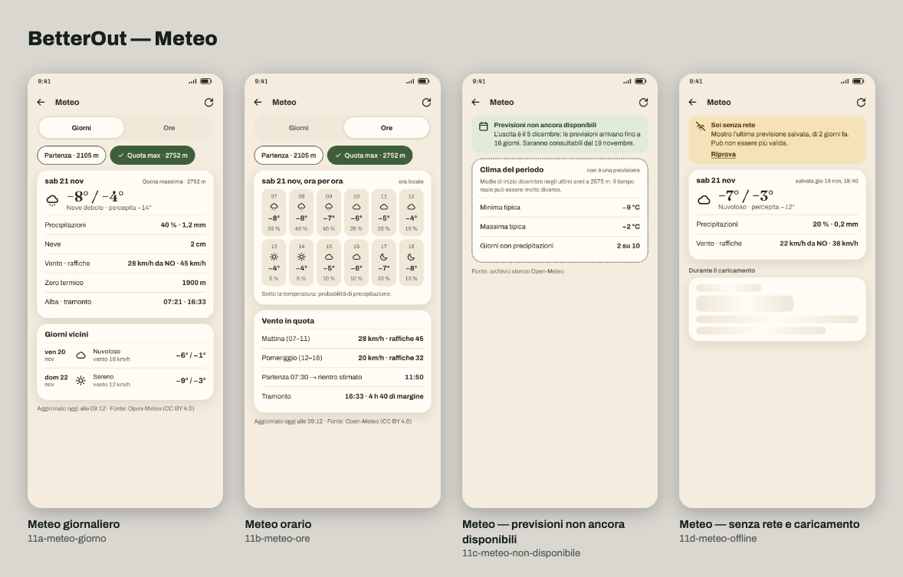
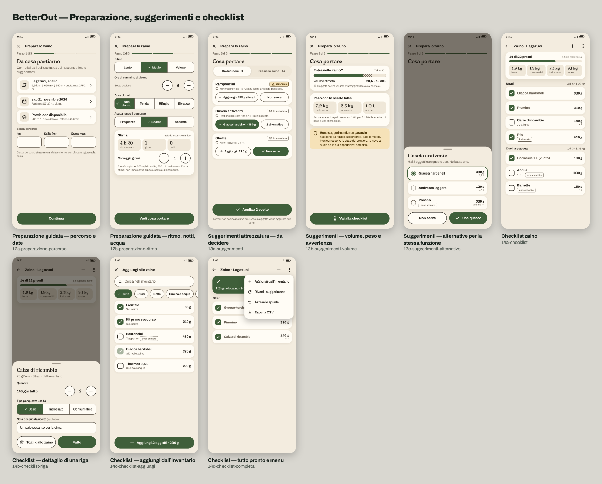
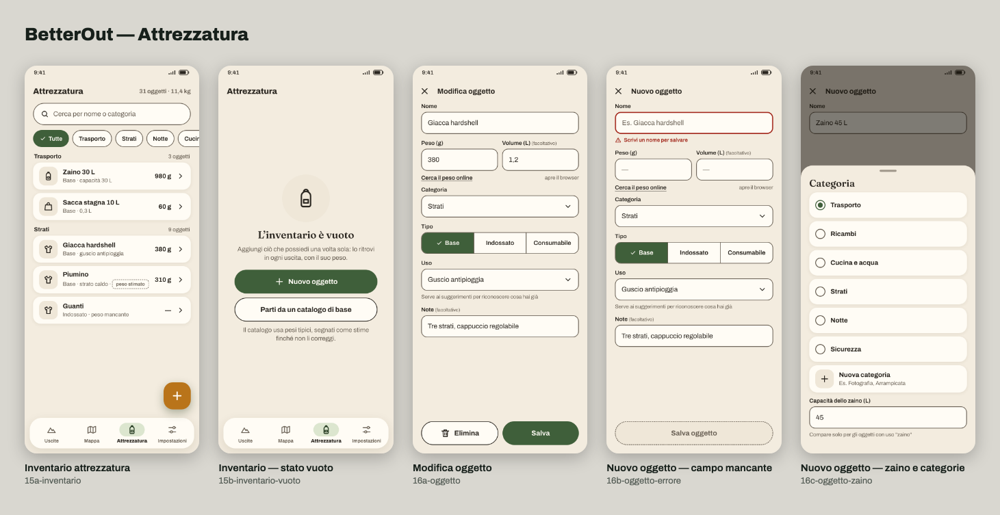
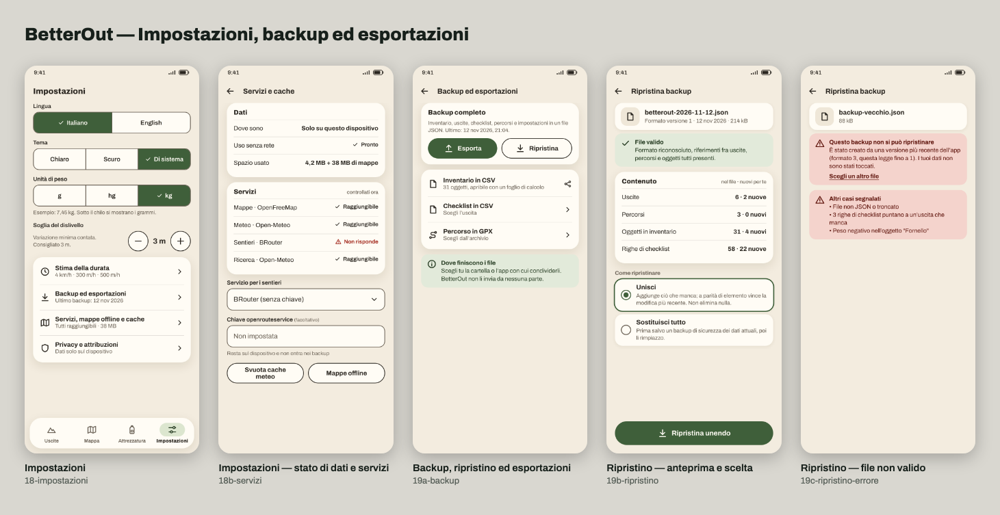
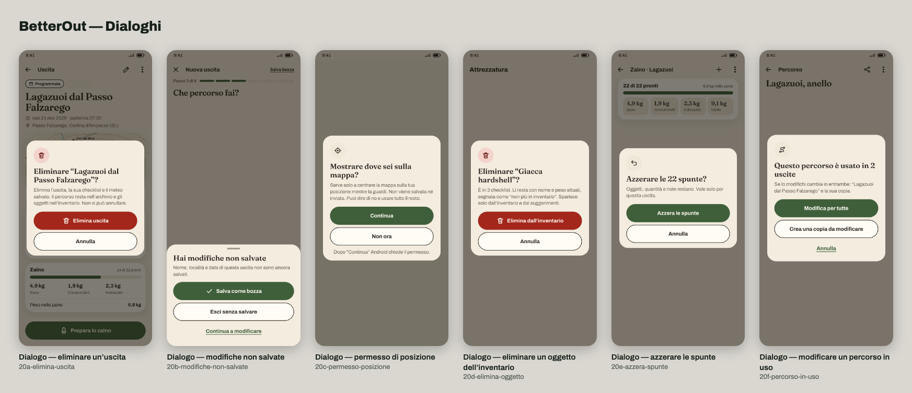

# Bozze grafiche

Direzione visiva scelta: **B · Rifugio**. Ogni immagine è una bozza con dati d’esempio, generata da `design/tools` (vedi `design/README.md`).

## Uscite

| Bozza | Schermata | Cosa mostra |
|---|---|---|
| [01a-home](bozze/01a-home.png) | Home | Prossima uscita, altre uscite, pulsante "+" |
| [01b-home-vuota](bozze/01b-home-vuota.png) | Home — stato vuoto | Primo avvio: nessuna uscita |
| [01c-home-scuro](bozze/01c-home-scuro.png) | Home — tema scuro | Stessa schermata con il tema scuro |
| [02a-elenco](bozze/02a-elenco.png) | Elenco uscite | Tutte le uscite con filtri per stato e ordinamento |
| [02b-elenco-filtro-vuoto](bozze/02b-elenco-filtro-vuoto.png) | Elenco uscite — filtro senza risultati | Un filtro attivo che non trova nulla |
| [10a-dettaglio](bozze/10a-dettaglio.png) | Dettaglio uscita | Stato, data, mappa, statistiche, meteo per punto, zaino; azione principale in basso |
| [10b-dettaglio-scuro](bozze/10b-dettaglio-scuro.png) | Dettaglio uscita — tema scuro | Stessa schermata con il tema scuro |
| [10c-dettaglio-menu](bozze/10c-dettaglio-menu.png) | Dettaglio uscita — altre azioni | Duplicazione, cambio di stato, eliminazione |
| [10d-duplica](bozze/10d-duplica.png) | Duplica uscita | La copia è indipendente: nuova data e spunte azzerate senza toccare l’originale |

## Creazione e modifica dell’uscita

| Bozza | Schermata | Cosa mostra |
|---|---|---|
| [03a-nuova-uscita](bozze/03a-nuova-uscita.png) | Nuova uscita — titolo e località | Primo passo del flusso "+"; la bozza si può salvare in ogni momento |
| [03b-modifica-uscita](bozze/03b-modifica-uscita.png) | Modifica uscita | Tutti i campi in una pagina, raggiungibile dal dettaglio |
| [03c-riepilogo](bozze/03c-riepilogo.png) | Nuova uscita — riepilogo | Ultimo passo: controllo e salvataggio |
| [04a-localita](bozze/04a-localita.png) | Ricerca località | Risultati con tipo, quota e regione; alternativa "scegli sulla mappa" |
| [04b-localita-errore](bozze/04b-localita-errore.png) | Ricerca località — errore di rete | Senza rete la ricerca fallisce ma l’uscita resta salvabile |
| [05-date](bozze/05-date.png) | Date e orari | Calendario, ora di partenza, durata, fuso orario della destinazione; "senza data" sempre possibile |
| [06-scelta-percorso](bozze/06-scelta-percorso.png) | Percorso — disegna o importa | Tre modi per associare un percorso, oppure nessuno |

## Mappa, percorsi e GPX

| Bozza | Schermata | Cosa mostra |
|---|---|---|
| [07a-editor-vuoto](bozze/07a-editor-vuoto.png) | Editor percorso — inizio | Mappa vuota con istruzione; annulla e ripristina non ancora attivi |
| [07b-editor-punti](bozze/07b-editor-punti.png) | Editor percorso — segui sentieri | Punti collegati lungo i sentieri; statistiche aggiornate a ogni punto |
| [07c-editor-selezione](bozze/07c-editor-selezione.png) | Editor percorso — punto selezionato | Trascinare sposta il punto; il riquadro offre inserimento ed eliminazione anche senza gesti |
| [07d-editor-manuale](bozze/07d-editor-manuale.png) | Editor percorso — tratto manuale | Il tratto manuale è tratteggiato e dichiarato non verificato |
| [07e-editor-errore](bozze/07e-editor-errore.png) | Editor percorso — routing non riuscito | L’errore è esplicito e la scelta resta all’utente: nessuna linea retta messa di nascosto |
| [08a-gpx-anteprima](bozze/08a-gpx-anteprima.png) | Importazione GPX — anteprima | File letto correttamente: mappa, statistiche e azioni |
| [08b-gpx-avvisi](bozze/08b-gpx-avvisi.png) | Importazione GPX — più tracciati, segmenti, quote assenti | I casi particolari sono dichiarati; i segmenti non vengono uniti |
| [08c-gpx-errore](bozze/08c-gpx-errore.png) | Importazione GPX — file non valido | Errore spiegato; nulla viene salvato |
| [08d-gpx-lettura](bozze/08d-gpx-lettura.png) | Importazione GPX — lettura in corso | File grande: avanzamento visibile, annullabile |
| [09-percorso](bozze/09-percorso.png) | Dettaglio percorso | Statistiche, profilo altimetrico, origine del percorso e uscite che lo usano |
| [17a-mappa](bozze/17a-mappa.png) | Mappa | Scheda Mappa: cartografia escursionistica, strati, posizione, nuovo percorso |
| [17b-archivio-percorsi](bozze/17b-archivio-percorsi.png) | Archivio percorsi | Percorsi salvati con origine, statistiche e stato dei dati |
| [17c-strati-offline](bozze/17c-strati-offline.png) | Mappa — strati e mappe offline | Scelta dello sfondo e scaricamento esplicito di un’area con dimensione e rimozione |

## Meteo

| Bozza | Schermata | Cosa mostra |
|---|---|---|
| [11a-meteo-giorno](bozze/11a-meteo-giorno.png) | Meteo giornaliero | Previsione per punto e quota, con fonte e ora di aggiornamento |
| [11b-meteo-ore](bozze/11b-meteo-ore.png) | Meteo orario | Ora per ora nella giornata dell’uscita, con vento e raffiche |
| [11c-meteo-non-disponibile](bozze/11c-meteo-non-disponibile.png) | Meteo — previsioni non ancora disponibili | Data oltre l’orizzonte: nessun dato inventato; il clima del periodo è separato e dichiarato |
| [11d-meteo-offline](bozze/11d-meteo-offline.png) | Meteo — senza rete e caricamento | Offline si vede l’ultimo dato con la sua età; l’errore non blocca nulla |

## Preparazione, suggerimenti e checklist

| Bozza | Schermata | Cosa mostra |
|---|---|---|
| [12a-preparazione-percorso](bozze/12a-preparazione-percorso.png) | Preparazione guidata — percorso e date | Passo 1: da dove arrivano i dati; si può preparare anche senza percorso |
| [12b-preparazione-ritmo](bozze/12b-preparazione-ritmo.png) | Preparazione guidata — ritmo, notti, acqua | Passo 2: la stima si aggiorna a ogni scelta ed è correggibile a mano |
| [13a-suggerimenti](bozze/13a-suggerimenti.png) | Suggerimenti attrezzatura — da decidere | Ogni voce ha il suo motivo; si distinguono mancanti, disponibili in inventario e alternative |
| [13b-suggerimenti-volume](bozze/13b-suggerimenti-volume.png) | Suggerimenti — volume, peso e avvertenza | Volume stimato rispetto allo zaino, con i dati mancanti in evidenza |
| [13c-suggerimenti-alternative](bozze/13c-suggerimenti-alternative.png) | Suggerimenti — alternative per la stessa funzione | Più oggetti dell’inventario con lo stesso uso: si sceglie quale portare |
| [14a-checklist](bozze/14a-checklist.png) | Checklist zaino | Avanzamento, pesi per tipo, oggetti per categoria con subtotale, quantità e spunte |
| [14b-checklist-riga](bozze/14b-checklist-riga.png) | Checklist — dettaglio di una riga | Quantità, tipo e nota valgono solo per questa uscita; l’inventario non cambia |
| [14c-checklist-aggiungi](bozze/14c-checklist-aggiungi.png) | Checklist — aggiungi dall’inventario | Ricerca e selezione multipla; ciò che è già nello zaino è indicato |
| [14d-checklist-completa](bozze/14d-checklist-completa.png) | Checklist — tutto pronto e menu | Stato completo dichiarato a parole; azzera spunte ed esporta CSV dal menu |

## Attrezzatura

| Bozza | Schermata | Cosa mostra |
|---|---|---|
| [15a-inventario](bozze/15a-inventario.png) | Inventario attrezzatura | Ricerca, filtri per categoria, peso e tipo di ogni oggetto, stime riconoscibili |
| [15b-inventario-vuoto](bozze/15b-inventario-vuoto.png) | Inventario — stato vuoto | Inventario vuoto con catalogo iniziale facoltativo |
| [16a-oggetto](bozze/16a-oggetto.png) | Modifica oggetto | Nome, peso, volume, categoria, tipo, uso, note |
| [16b-oggetto-errore](bozze/16b-oggetto-errore.png) | Nuovo oggetto — campo mancante | L’errore è scritto accanto al campo, non solo colorato |
| [16c-oggetto-zaino](bozze/16c-oggetto-zaino.png) | Nuovo oggetto — zaino e categorie | Per gli zaini compare la capacità; le categorie si possono aggiungere |

## Impostazioni, backup ed esportazioni

| Bozza | Schermata | Cosa mostra |
|---|---|---|
| [18-impostazioni](bozze/18-impostazioni.png) | Impostazioni | Lingua, tema, unità, soglia del dislivello e accesso alle sezioni di servizio |
| [18b-servizi](bozze/18b-servizi.png) | Impostazioni — stato di dati e servizi | Cosa funziona senza rete, quali servizi rispondono, cache e chiavi facoltative |
| [19a-backup](bozze/19a-backup.png) | Backup, ripristino ed esportazioni | Backup completo JSON, ripristino da file, CSV e GPX, condivisione |
| [19b-ripristino](bozze/19b-ripristino.png) | Ripristino — anteprima e scelta | Validazione, conteggi, unione o sostituzione; prima di sostituire si salva un backup di sicurezza |
| [19c-ripristino-errore](bozze/19c-ripristino-errore.png) | Ripristino — file non valido | Il file viene rifiutato prima di toccare i dati |

## Dialoghi

| Bozza | Schermata | Cosa mostra |
|---|---|---|
| [20a-elimina-uscita](bozze/20a-elimina-uscita.png) | Dialogo — eliminare un’uscita | Conferma con il nome e con ciò che viene (e non viene) eliminato |
| [20b-modifiche-non-salvate](bozze/20b-modifiche-non-salvate.png) | Dialogo — modifiche non salvate | Tre uscite chiare: salvare come bozza, scartare, restare |
| [20c-permesso-posizione](bozze/20c-permesso-posizione.png) | Dialogo — permesso di posizione | Spiegazione prima della richiesta di sistema; rifiutare non blocca nulla |
| [20d-elimina-oggetto](bozze/20d-elimina-oggetto.png) | Dialogo — eliminare un oggetto dell’inventario | La regola è dichiarata: checklist e storico restano |
| [20e-azzera-spunte](bozze/20e-azzera-spunte.png) | Dialogo — azzerare le spunte | Azione reversibile solo a mano: conferma breve |
| [20f-percorso-in-uso](bozze/20f-percorso-in-uso.png) | Dialogo — modificare un percorso in uso | Avviso quando il percorso è associato a più uscite |
